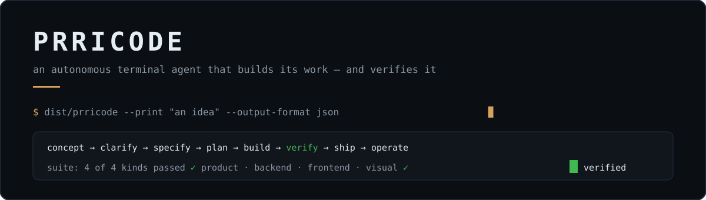
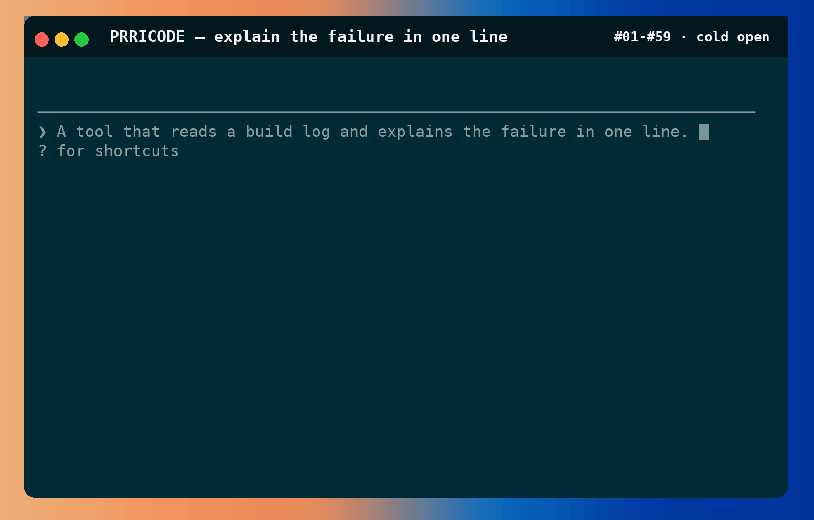

<h1 align="center">PRRICODE</h1>

<p align="center">
  <picture>
    <source media="(prefers-reduced-motion: no-preference)" srcset="assets/readme/hero.svg">
    
  </picture>
</p>

<p align="center"><strong>A coding agent for the terminal that ships its own verification.</strong><br>
Independently implemented against the static structure of a pinned reference build —
<code>2.1.303</code>, Linux x86-64, SHA-256
<code>375988f457756524234695cf2d8f64ace99c5f68682e47ea24862a843c191450</code> —
plus a multi-provider model layer the reference build does not have.</p>

<p align="center">
  
</p>

*The demo is the repository's own renderer, recorded: `scripts/demo/capture.ts` drives the interactive UI beat by beat and writes the real screen rows; `scripts/demo/assemble.py` composites the window chrome and encodes the measured cadence — 414 frames at 10 fps, one play, no looping.*

---

## The proof comes first

Nothing on this page is asserted that is not measured, and every measure is re-runnable in one command:

```bash
bun run scripts/regenerate-report.ts   # the clone's parity report
bun run scripts/verify-rea.ts          # re-derives 13 target surfaces from source; must pass
bun run scripts/verify-product.ts      # the product suite — 4 kinds
npx vitest run --maxWorkers=4          # the whole test suite
npx tsc --noEmit                       # the types
```

| Check | What it proves | Measured | Date |
|---|---|---|---|
| parity report | 42 rows over the reference MD's behaviours: `match`, `mismatch`, `not-tested` — no `unknown` | 37 `match` · 2 `mismatch` · 3 `not-tested` | 2026-10-26 |
| surface verifier | all 13 re-derived surfaces are accounted for | ok — "the record accounts for every entry the target has" | 2026-10-22 |
| product suite | product · backend · frontend · visual | **4 of 4 kinds passed**, exit 0 | 2026-10-22 |
| test suite | everything pinned by a test | 63 files, 3 115 tests, green | 2026-10-26 |

*(The parity row's exact counts move only when a `mismatch` is closed or opened; re-run the command to read today's.)*

## What it does

```bash
bun install                     # the build never consults bun.lock; the tests do
bun run test                    # the whole suite
bun run typecheck               # tsc --noEmit
bun run build                   # → dist/prricode, one self-contained executable
./dist/prricode --version
./dist/prricode --print 'hello' --output-format json
```

`CLAUDE_CONFIG_DIR` relocates the configuration root; the first run creates it `0700` and reports where it put it.

In **print mode** it is a session that writes exactly one result document (`--output-format json|stream-json|text`). **Interactive mode is the default** — run the binary bare and the terminal UI takes over.

## Try the TUI on your own machine

```bash
bun run build            # → dist/prricode — one self-contained file, no host runtime
./dist/prricode          # the interactive session — a composer is waiting
```

*(Measured on this machine: the build takes about a second and lands a ~90 MB executable.)*

Type a short brief, press **Enter**, and the run streams its real work: the eight stages advance, every tool call lands with its result beside it, and anything not covered by a permission rule calls back with the approval prompt — the same one the demo above shows:

```text
  ❯ Yes ✔
    Yes, and don't ask again for this Bash call
    No, and tell PRRICODE what to do differently (esc)
  enter to confirm · esc to cancel
```

Keys worth knowing on the first screen:

| Key | What it does |
|---|---|
| `Enter` | sends the brief; confirms a prompt |
| `esc` | declines a prompt, cancels a turn; `esc` again clears the line |
| `?` | opens the shortcuts overlay — only on an **empty** line, so it never eats your draft |
| `/exit` | leaves the session (alias `/quit`) |

The command registry is the transcript's backbone — type `/` in the composer and read them live (`/help` lists every one):

| Command | Job |
|---|---|
| `/help`, `/status` | help, and the full status: version, model, connectivity, tool states |
| `/provider list` / `add` / `use` / `test` | connect a model: list the integrations, name a credential, activate the connection, prove it live |
| `/model`, `/catalog` | set the model; read the catalogue it can come from |
| `/usage`, `/context` | session usage; the current context as a grid |
| `/config`, `/keybindings` | settings; your keyboard-shortcuts file |
| `/clear`, `/compact`, `/resume` | a fresh empty session (the old one stays resumable); compress the history; pick a previous conversation back up |
| `/skills`, `/skill-doctor` | the available skills; which loaded skills are going unused |
| `/version`, `/exit` | the build this session runs; leave |

Connecting a model is two commands:

```text
/provider list                                  # the integrations and their env names
/provider add mine --credential-env <ITS_VAR> --use
```

Credentials are **derived, not kept**: a stored secret is consulted newest-first, then the environment — a connection record carries no secret field of its own. `/provider test` proves the connection live before you spend a brief on it.

## Two layers, two claims

**Layer 1 — the parity clone.** Same architecture, same observable behaviour, same performance envelope. The bar is machine-checkable: *every surface the target has is enumerated, every entry classified with a file and an offset, and nothing unaccounted for.* `verify-rea.ts` re-derives 13 surfaces (tools, browser, telemetry, environment, settings, hooks, flags, native inventory) from the reference source and fails when the target has an entry the record does not name — e.g. 1 285 environment variables and 3 084 telemetry event names, as lower bounds.

**Layer 2 — the product.** Written to specification *before* implementation, in `docs/protocol/`:

- **Our own JSON-RPC over stdio** — three frame kinds, stable kebab-case error codes beside human messages, and **one capability record asked of anything**: `enabled`, and when not `unsupported: <why>` →
- **The model layer** — a provider is *data* and one engine speaks it; three wire dialects (`chat`, `messages`, `responses`) as a property of the path; the catalogue fetched per provider and merged over a shipped snapshot; reasoning **effort as a named overlay the catalogue declares**, never a rule in code; credentials keyed by integration and derived (stored keys newest-first, then the environment); **no cross-provider fallback** — a gone model fails loudly.
- **The pipeline** — concept → clarify → specify → plan → build → verify → ship → operate with **one stage interface and three deliveries** (in-process, package, subprocess) that the pipeline provably cannot tell apart.
- **Approvals as rules** — the first layer's own permission rule language (`allow`/`ask`/`deny`), reused verbatim; a matching rule decides without asking, and an answer is attributed to the peer that gave it.
- **The motion system and goldens** — one vocabulary of seven motions with closed-form easings and a quantised frame; six **golden frames** recorded as *picture bytes* with a fingerprint staleness check, so a stale picture cannot pass quietly.

## The checklist the product enforces on itself

The verification suite runs four kinds, each a thing that can fail — each kind was *made to fail out loud* with a deliberate mutation before it was trusted to pass:

| Kind | What it mocks up on itself to go red |
|---|---|
| **product** | forced the comparison's verdict → an over-claiming run now fails at `verify` and releases nothing |
| **backend** | swallowed an endpoint refusal → the refusal is now a degradation with a reason, never a success |
| **frontend** | changed one byte of a drawn frame → golden byte-mismatch caught |
| **visual** | edited a theme source without touching a picture → every golden went `stale` while the pin stayed green |

## Repository map

| Path | What it is |
|---|---|
| `src/config/` | the five settings tiers and the two distinct precedence orderings |
| `src/provider/` | the route adapters, the model catalog, the credential registry, the transport (retry loop, SigV4) |
| `src/permissions/`, `src/sandbox/` | the rule engine and the sandbox plan |
| `src/protocol/` | the layer-2 JSON-RPC surface over stdio, with the shared capability record |
| `src/model/` | providers-as-data, the three dialects, the catalogue and overlays, the credential integration |
| `src/pipeline/` | the eight-stage Product Builder pipeline with three delivery modes |
| `src/approvals/` | the approval decision point over the first layer's rule language |
| `src/ui/` | the TUI, the theme, the renderers, the motion system and the drawn surface |
| `src/product/` | the product run — idea in, verified shippable product out |
| `scripts/verify-rea.ts` | the machine-checkable completeness verifier |
| `scripts/verify-product.ts` | the four-kind product verification suite |
| `tests/visual/goldens/` | the golden frames' picture bytes and fingerprint records |
| `docs/reverse-engineering/` | the evidence — per-surface findings, the coverage audit, the handoff brief |
| `docs/compatibility/` | the compatibility report and the per-surface conformance documents |

## If you're a coding agent working in this repo

Read [`AGENTS.md`](AGENTS.md) first — it short-contracts the naming rule, the honest-report rule, RAM discipline, path-limited commits, and which files are orchestrator-owned. The long form is at [`docs/reverse-engineering/HANDOFF.md`](docs/reverse-engineering/HANDOFF.md).

## Working with the docs

| Doc | What it is |
|---|---|
| [`docs/PROGRESS.md`](docs/PROGRESS.md) | every milestone and its proof |
| [`docs/VERIFICATION.md`](docs/VERIFICATION.md) | the single verification account, including what is *not* claimed |
| [`docs/DIVERGENCE-LAYER-2.md`](docs/DIVERGENCE-LAYER-2.md) | the layer-2 concept, locked decisions |
| [`docs/reverse-engineering/COVERAGE-AUDIT.md`](docs/reverse-engineering/COVERAGE-AUDIT.md) | what was observed, with file and offset, for every claim |

## Honest ledger

Everything above is measured. Three rows stay `mismatch` (with reasons in `results.md`) and three stay `not-tested` as project extensions with no target counterpart — a `match` will not be declared until the whole contract compares. The environment and telemetry name-surfaces are lower bounds by construction. The full account, including what is *not* claimed, lives in [`docs/VERIFICATION.md`](docs/VERIFICATION.md).

## License

MIT — see [`LICENSE`](LICENSE).
