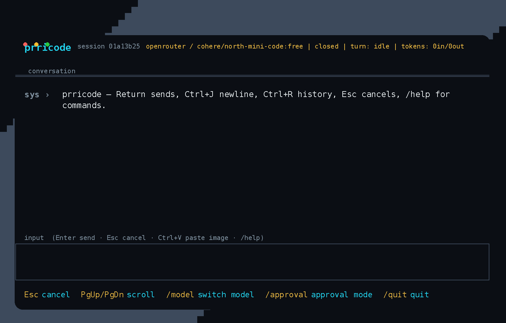
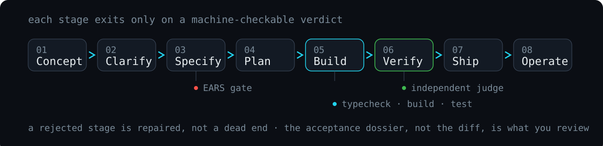

# prricode

**An autonomous AI coding agent that lives in your terminal.**

prricode takes the whole job, not a slice of it. Bring a rough idea and it
carries it end to end — conversation → specification → plan → build →
verification → delivery → operation — with a human approval at the
irreversible moments (deploy, spend, publish) rather than at every edit.

<p align="center">
  
</p>
<p align="center">
  <a href="assets/prricode-demo.mp4">mp4</a> · <a href="assets/prricode-demo.webm">webm</a>
</p>

## What it is

A coding agent you drive with words, not flags: run `prricode` with no
arguments and the whole thing is a TUI — sessions, providers, models, themes,
approvals, and the Product Builder pipeline are all commands you type. Nothing
to memorise, no second app to learn, and the config file is optional.

What makes it different is underneath. A gated pipeline where **each stage
exits only on a machine-checkable verdict**, an **independent verifier** that
judges work the builder never saw, and a reviewable artifact that is an
**acceptance dossier** — what changed, what was verified and how, evidence,
residual risk, and what was not tested — rather than a diff you have to trust.

<p align="center">
  
</p>

The autonomy rule: full autonomy where an oracle exists, human judgement where
it doesn't. The build runs open inside a disposable worktree — you already
consented at the plan gate — and the gates are what judge the result.

## What it does

- **A real agent loop with tools** — `shell` (sandboxed), `read_file`,
  `write_file`, `edit_file`, `glob`, `grep`, `web_fetch`, `task` (subagents),
  and `computer` (screen + input). Built for small models: fenced-JSON
  recovery, argument repair, dedupe, and retry, so a 3B model on your laptop
  still lands its tool calls.
- **Any model** — one OpenAI-compatible client with first-class presets for
  Ollama (local and cloud), OpenRouter, the Kilo AI Gateway, OpenAI, and any
  custom endpoint. Switch provider and model live from the TUI (`/provider`,
  `/model`) — no restart. Offline echo provider for tests.
- **Remembers** — every message, tool call, and result is persisted in SQLite.
  Resume, fork, and compact sessions across runs.
- **Verification, not vibes** — deterministic gates after every build task, an
  adversarial verifier with structural context isolation, and the dossier.
- **Approvals that fit your risk appetite** — allow once, for the session, or
  always in this workspace (persisted as a policy amendment), with a timeout
  that denies rather than hangs.
- **Credentials stored safely** — `prricode auth token <provider>` keeps keys
  in a 0600 store; `prricode logout <provider>` drops one, or all of them.
  Keys never land in the repo or in logs.
- **Extensible** — `SKILL.md` capability bundles, a stdio MCP client, 25
  bundled themes, `Ctrl+V` image paste, and STT/TTS plumbing for models with
  ears.

## The terminal is the interface

Every setting, command, and configuration is reachable from the composer. The
config file and environment variables exist as *optional equivalents* for
those who prefer files or CI; the TUI reads them at startup.

- **Composer**: `Return` sends, `Ctrl+J` newline, `Ctrl+R`/`Ctrl+P`/`Ctrl+N`
  history, `Ctrl+G` edit in `$EDITOR`, `Alt+B`/`Alt+F` word moves, `Ctrl+K`/
  `Ctrl+Y` kill/yank, `Ctrl+L` clear
- **`@`** insert a file path, **`!cmd`** run a shell command in the workspace,
  **`Ctrl+V`** paste an image from the clipboard
- **`Ctrl+C`/`Esc`** interrupt a running turn without losing the session
- **Approvals inline**: sensitive tool calls pause with `y` allow-once / `s`
  allow-for-session / `a` always-in-this-workspace / `n` deny
- **Slash commands** — settings and pipeline, all in-app:

  | Group | Commands |
  |---|---|
  | Session | `/new`, `/resume`, `/sessions`, `/clear`, `/compact`, `/quit` |
  | Settings | `/model`, `/provider`, `/approval`, `/yolo`, `/theme`, `/goal` |
  | Product Builder | `/concept`, `/spec`, `/plan`, `/build`, `/ship`, `/deploy`, `/operate`, `/dossier` |
  | Info | `/help`, `/?` |

The full keymap, the approval flow, theming, and the file/env equivalents are
in [`docs/TUI-GUIDE.md`](docs/TUI-GUIDE.md).

## Pick your brain

| Provider | `--provider` | Key env | Notes |
|---|---|---|---|
| Echo (offline) | `echo` | — | No network; replies `echo: <text>`. Tests and protocol debugging. |
| Ollama (local) | `ollama` | — | `/api` native surface with tools. |
| Ollama Cloud | `ollama-cloud` | `OLLAMA_API_KEY` | Hosted models, same account. |
| OpenRouter | `openrouter` | `OPENROUTER_API_KEY` | Hundreds of models, one key. |
| Kilo AI Gateway | `kilo` | `KILO_API_KEY` | `:free` models work anonymously. |
| OpenAI | `openai` | `OPENAI_API_KEY` | |
| Anything else | `custom` | yours | Any OpenAI-compatible endpoint via `--base-url`. |

## Quickstart

```bash
git clone https://github.com/RavaniRoshan/prricode.git
cd prricode
cargo build --release

# the TUI — the default way in: provider/model are picked or typed in-app
./target/release/prricode

# offline, no model needed
./target/release/prricode exec "summarize this repo" --provider echo

# local model
ollama pull qwen2.5-coder:3b
./target/release/prricode exec "create hello.py that prints hi, then run it" \
  --provider ollama --model qwen2.5-coder:3b

# free hosted model, no key
./target/release/prricode exec "say hi" --provider kilo --model liquid/lfm-2.5-2.6b:free

# serve the protocol over stdio
./target/release/prricode serve --provider ollama
```

Or carry a concept all the way through the pipeline:

```bash
./target/release/prricode                       # then: /concept <your idea>
```

## The protocol

A stable JSON-RPC 2.0 surface over stdio, so any editor, TUI, or script can
drive the same agent. A session in three lines:

```jsonc
{"jsonrpc":"2.0","id":1,"method":"initialize","params":{"clientInfo":{"name":"my-ui","version":"0.1.0"}}}
{"jsonrpc":"2.0","id":2,"method":"session/start","params":{"commandId":"…","workspaceRoot":"/path/to/project"}}
{"jsonrpc":"2.0","id":3,"method":"turn/start","params":{"commandId":"…","sessionId":"…","input":[{"type":"text","text":"fix the failing test"}]}}
```

Progress streams back as notifications: `turn/item` deltas, `tool_use`,
`approval/requested`, `turn/completed`. The pipeline is drivable too
(`pipeline/conceptSet`, `pipeline/specRead`, `pipeline/verifyRead`, …).

## Under the hood

```
prricode/
  crates/
    prricode-core/        protocol types, schema fingerprint, 37 error kinds
    prricode-cli/         18 subcommands; bare `prricode` launches the TUI
    prricode-server/      JSON-RPC dispatch, sessions, goals, notifications
    prricode-agent/       turn loop, tool registry, approval engine
    prricode-provider/    echo + ollama + OpenAI-compatible presets, credential store
    prricode-persistence/ SQLite: sessions, items, goals, usage, settings
    prricode-sandbox/     bubblewrap execution
    prricode-computer-use/ X11 screenshots + input, Wayland probe
    prricode-workflow/    workflow runs with child control
    prricode-skills/      SKILL.md loading and import
    prricode-mcp/         MCP stdio client
    prricode-voice/       speech-to-text / text-to-speech plumbing
    prricode-tui/         the terminal UI: 25 themes, image paste, /commands
    prricode-spec/        EARS requirements, layered specs, task graph + waves
    prricode-verify/      gate runner, adversarial verifier, acceptance dossier
    prricode-ship/        release path, deploy, operate (rollback)
    prricode-pipeline/    stage orchestration for the Product Builder
  docs/                   protocol, configuration, TUI, and operator docs
  tests/                  e2e scenario driving the real binary
```

## Documentation

- `docs/FIRST-PRODUCT.md` — **start here**: a twenty-minute lesson from a rough
  idea to a verified product, with the dossier at the end
- `docs/TUI-GUIDE.md` — **the terminal is the interface**: every command, key,
  and setting, all reachable from the TUI
- `docs/PRD.md` / `docs/PRD-onepager.md` — the product requirements and the
  positioning card
- `docs/PROTOCOL.md` — the JSON-RPC surface: methods, types, error codes
- `docs/PROTOCOL-CONFORMANCE.md` — what the protocol surface is and how it was
  verified; `docs/CONFORMANCE-DECISIONS.md` — how the ambiguous parts were
  resolved
- `docs/CONFIGURATION.md` — providers, keys, config file (the TUI equivalents
  are listed alongside)
- `docs/COMPUTER_USE.md` — permissions, actions, Xvfb testing
- `docs/TESTING.md` — test matrix, live-provider verification, e2e
- `docs/SKILLS.md` / `docs/VOICE.md` — skill format, speech setup
- `docs/ARCHITECTURE.md` — request path, storage, notifications

## Development

```bash
cargo build
cargo test --workspace
cargo clippy --workspace
cargo fmt --check
```

## License

MIT — see [LICENSE](LICENSE).
